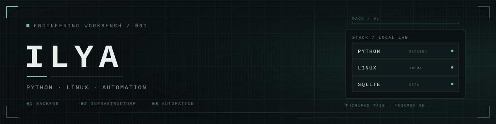

<p align="center">
  
</p>

> Building useful software. Exploring systems. Automating things.

## ABOUT

Студент направления «Информационные системы и программирование». Разработку изучаю
самостоятельно и предпочитаю практику: собрать работающую вещь, разобраться, как она
устроена, и довести до состояния, которым можно пользоваться.

Основное направление — Python и backend: Telegram-боты, работа с базами данных,
небольшие веб-приложения и API, автоматизация рутины. Отдельная часть практики —
Linux и домашняя инфраструктура: виртуализация, размещение сервисов, диагностика.
В информационной безопасности интересует инженерная сторона — как системы ломаются
и как делать их устойчивее.

## CURRENT FOCUS

| Направление | Сейчас |
| --- | --- |
| **Python backend** | структура проектов, работа с БД, обработка ошибок |
| **REST API** | проектирование эндпоинтов, валидация, HTTP *(изучаю)* |
| **Linux** | Ubuntu, SSH, размещение сервисов |
| **Docker** | контейнеризация и compose *(изучаю)* |
| **Автоматизация** | скрипты, боты, интеграции с API |
| **Информационная безопасность** | базовая защита веб-приложений и доступов *(изучаю)* |

## TECH STACK

| Категория | Технологии |
| --- | --- |
| **Languages** | Python, C#, Java, SQL, Dart (учебный проект) |
| **Backend** | Python, Telegram Bot API, REST API (изучаю) |
| **Databases** | SQLite, SQL Server |
| **Infrastructure** | Linux (Ubuntu), Proxmox VE, Git, Docker (изучаю) |
| **Tools** | VS Code / OpenCode, Visual Studio, Android Studio |
| **Desktop / Mobile** | WPF, Flutter |

Список отражает не всё, что доводилось видеть, а то, с чем есть практика. Python
и Linux — основа; C#, Java, Dart и SQL — учебные проекты; Docker и проектирование
REST API сейчас в процессе изучения.

## SELECTED PROJECTS

### FLUTTER_APPLICATION_1

**Мобильное приложение интернет-магазина** · дипломный проект

Каталог товаров, карточка товара, корзина, оформление заказа, авторизация и режим
продавца. Код разделён на слои `domain` / `data` / `presentation`, состояние —
Riverpod, навигация — `go_router`.

**Задача:** пройти полный пользовательский сценарий покупки и выстроить структуру,
в которой mock-данные можно заменить реальным API.

**Стек:** `Flutter` · `Dart` · `Riverpod` · `go_router`

**Статус:** учебная версия. Авторизация и серверная часть работают на заглушках;
поиск и профиль пользователя заявлены в архитектуре, но пока не реализованы.

[Репозиторий →](https://github.com/pila0873/FLUTTER_APPLICATION_1)

### Hogwarts-education

**Многостраничный сайт на HTML/CSS** · учебная работа

Главная, факультеты, преподаватели и галерея. Без фреймворков, сборки и внешних
зависимостей — практика структуры страниц, навигации и адаптивной вёрстки.

**Стек:** `HTML` · `CSS`

[Репозиторий →](https://github.com/pila0873/Hogwarts-education)

#### В работе

Проекты, исходники которых пока не опубликованы. Ссылок здесь нет, чтобы не выдавать
их за публичные репозитории.

- **TeamTasker** — учебный проект на C#/WPF: учебные задачи, роли преподавателя
  и студента, назначение заданий, работа с базой данных.
- **Telegram-бот с рецептами** — Python + SQLite: подбор недорогих рецептов,
  категории блюд, поиск по ингредиентам. Проект развивался в сторону размещения
  на собственном Linux-сервере.

## HOMELAB

Домашняя лаборатория для практики с Linux и виртуализацией. Это не production:
задача — проверять идеи, разворачивать сервисы и разбираться с проблемами на своём
железе.

```text
ThinkPad T420
└── Proxmox VE
    ├── VM · Linux-сервер
    ├── VM · тестовые сервисы
    └── VM · эксперименты
```

- Linux-серверы и SSH-доступ.
- Размещение Telegram-ботов и тестовых приложений.
- Сеть, доступы и обслуживание виртуальных машин.

## LEARNING

- **Docker** — контейнеризация сервисов, compose, перенос окружений.
- **REST API** — проектирование, валидация, коды ответов.
- **Информационная безопасность** — защита веб-приложений, доступы, базовая гигиена.
- **Android** — продолжение мобильной практики с Flutter и Android Studio.

## CONTACTS

- GitHub: [@pila0873](https://github.com/pila0873)
- По коду и проектам — Issues в соответствующем репозитории.

---

<sub>Engineering Workbench · 2026</sub>
